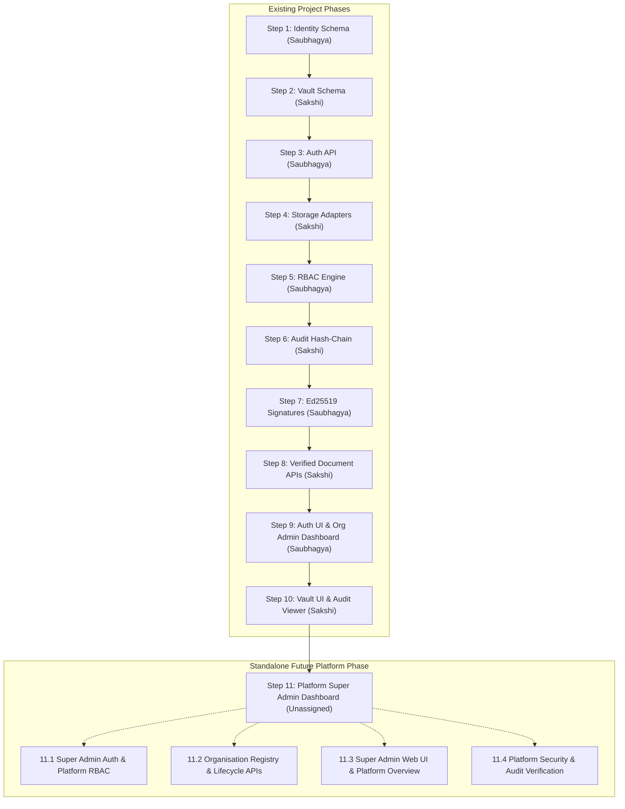

# Step 11 — Platform Super Admin Dashboard

> **Project Phase:** Step 11 (Future Planned Phase)  
> **Status:** 📋 Planned (Scheduled after Steps 9 and 10)  
> **Ownership:** **Unassigned** (Standalone platform phase; NOT assigned to Member 1 / Saubhagya or Member 2 / Sakshi)  
> **Notice:** This document constitutes the master project specification and execution plan for Step 11. No runtime application code, backend endpoints, database migrations, or UI views have been implemented yet.

---

## 1. Purpose

The **Platform Super Admin Dashboard** provides a centralized, platform-wide administrative interface for operators and system administrators responsible for governing the multi-tenant DocuVault infrastructure.

This capability is architecturally separated from the existing **Organisation Admin Dashboard**:

- The **Organisation Admin Dashboard** empowers individual tenant administrators to manage their own internal departments, positions, member credentials, and digital locker configurations.
- The **Platform Super Admin Dashboard** governs the overall platform, providing global oversight of all registered tenant organisations, tenancy lifecycles, platform health, and system-level compliance.

---

## 2. Role Distinction & Access Boundaries

To maintain strict security isolation and prevent unauthorized access or privilege escalation, the system enforces a strict boundary between tenant-level administration and platform-level administration:

| Dimension             | Organisation Admin (Tenant Scope)                                                                         | Platform Super Admin (Platform Scope)                                                                                                   |
| :-------------------- | :-------------------------------------------------------------------------------------------------------- | :-------------------------------------------------------------------------------------------------------------------------------------- |
| **Scope**             | Single tenant organisation enclave                                                                        | Platform-wide infrastructure and tenancy registry                                                                                       |
| **Responsibilities**  | Internal employees, functional departments, positions, clearance levels, permissions, and tenant settings | All registered tenant organisations, platform configuration, global health, and tenancy lifecycle                                       |
| **Authentication**    | Tenant authentication via `/api/v1/auth/login`                                                            | Dedicated platform super-admin authentication gateway                                                                                   |
| **Access Boundaries** | Cannot view or access other organisations or platform-level settings                                      | Cannot bypass cryptographic access controls or view tenant document payloads without explicit authorization and immutable audit logging |
| **Audit Ledger**      | Scoped to organisation's hash-chained audit ledger (`audit_logs`)                                         | Recorded in a distinct platform-level audit security ledger                                                                             |

> [!IMPORTANT]
> Organisation Administrators must never be permitted to access the Platform Super Admin Dashboard or its platform endpoints. Platform Super Administrators must never silently bypass tenant security controls.

---

## 3. Planned Feature Sets

### 1. Platform Overview

- **Global Tenancy Metrics:** Real-time visibility into the total count of registered organisations, broken down by operational status (Active, Suspended, Deactivated).
- **Enclave Health Indicators:** High-level operational health status across tenant enclaves, database connection pools, and object storage connectivity.
- **Aggregated Platform Statistics:** Summary cards detailing total platform users, active storage volume, and cryptographic signature volume without compromising tenant data privacy.

### 2. Organisation Management

- **Organisation Registry:** Searchable, filterable directory of all registered tenant organisations (legal name, tenant UUID, organisation type, creation date, and status).
- **Tenant Detail Inspector:** View detailed organisation parameters, registration timestamps, primary administrator contact information, and assigned subscription/licensing tier.
- **Metadata Editing:** Update organisation-level metadata (legal registration details, organizational category, compliance contact).
- **Tenancy Lifecycle Controls:**
  - **Activate:** Reinstate access for an approved or restored organisation.
  - **Suspend:** Temporarily disable access across all users within an organisation (e.g., during compliance reviews or security investigations).
  - **Deactivate:** Formally decommission a tenant enclave in accordance with defined data retention and regulatory policies.

### 3. Platform Administration

- **Global Platform Configuration:** Manage platform-wide runtime settings, storage backend parameters, rate-limiting profiles, and default classification tiers.
- **System Activity & Telemetry:** Monitor real-time operational metrics, background task statuses, and error diagnostics across services.
- **Operational Notices:** Capability to broadcast system-wide maintenance announcements or operational advisories to tenant portals.

### 4. Super Admin Access Control

- **Dedicated Authentication Gateway:** Isolated authentication mechanism distinct from standard tenant sign-in endpoints.
- **Platform RBAC Matrix:** Granular permission system specifically designed for platform administrators (e.g., `PLATFORM_VIEW`, `ORG_MANAGE`, `PLATFORM_CONFIG`, `PLATFORM_AUDIT`).
- **Authorization Guardrails:** Rigorous checks ensuring no organisation administrator or standard user token can resolve platform-level routes.

### 5. Platform Audit & Security

- **Immutable Super-Admin Audit Log:** Every action executed within the Platform Super Admin Dashboard (such as suspending an organisation or modifying platform settings) is immutably logged with actor identity, timestamp, IP address, and payload parameters.
- **Tenant State Traceability:** Complete tamper-evident audit history of all status transitions for every organisation.
- **Sensitive Data Protection:** Zero-knowledge principles ensuring platform administrators cannot decrypt private tenant documents or view tenant encryption keys.

---

## 4. Execution Roadmap & Planning

Execution of Step 11 will commence following the verified completion of **Step 9** (Frontend Auth & Organisation Admin Dashboard) and **Step 10** (Vault UI, Upload Form & Audit Viewer).

### Pre-Implementation Checklist (To be reviewed prior to starting Step 11):

1. **Completion of Steps 9 and 10:** All tenant-facing and vault-facing interfaces fully delivered and tested.
2. **Resource Allocation:** Assignment of ownership for Step 11 (independent from the alternating Member 1 / Member 2 schedule).
3. **Database Schema Design:** Specification of super-admin identity tables, platform roles, and platform audit tables.
4. **Security Boundary Review:** Verification of endpoint access isolation and middleware validation.
